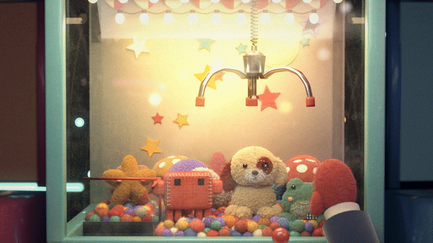
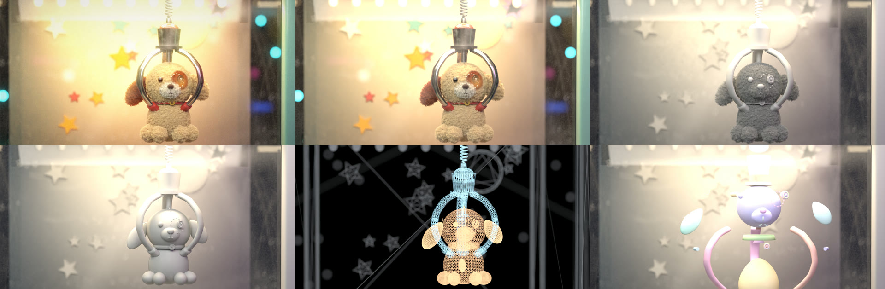
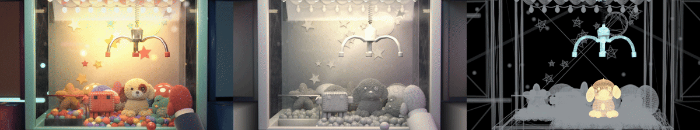
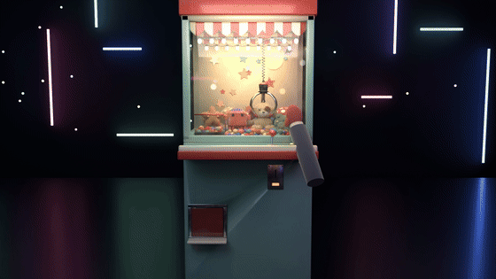
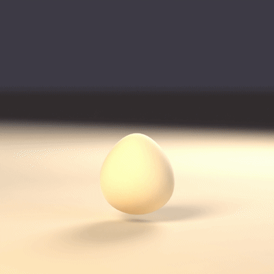

# Claw Machine

**English** · [简体中文](README.zh-CN.md)

**A 59-second felt stop-motion short, modelled, animated, lit and rendered by Python scripts driving Blender. No generated images, no generated video, no downloaded or generated 3D models.**



The claw in an old claw machine is "loose" for a reason: it has fallen for one plush, a patched-up dog, and keeps putting it back. It delivers every other toy, hides the dog in a corner, and watches the machine empty. Then a mitten keeps coming back to the glass, and the dog keeps looking out at it. The claw grips with full strength for the first time, carries the dog to the chute and lets go. Next morning a new box of plushes pours in.

Built by **Claude Fable 5.2** (an Anthropic model) working in Claude Code, at the request of [zahT3](https://github.com/zahT3). Not affiliated with Anthropic.

## It is a real 3D scene, not a picture

The same frame, peeled back: the finished film, the raw render, every material swapped for grey clay, the fur removed, the wireframe, and the dog and the claw pulled apart into the shapes they are made of.



The same 34 drawings of the film, rendered again as clay and as wireframe. Every frame lines up.



Time frozen at 2.0 s, the camera taken once round the machine. The back of the machine is open, like a stop-motion set.



The dog, assembled in the order `build_dog()` builds it: ellipsoids, a button, stitches along the surface, then 330,000 strands of fur.



## How it works

| Piece | File | What it does |
|---|---|---|
| Set and cast | `yj/machine.py`, `yj/plush.py`, `yj/claw.py` | Every object is built from spheres, boxes, cylinders and swept tubes. Seven plush designs, the machine, the claw rig, the shop around it. |
| Materials | `yj/mats.py`, `make_tex.py` | Fabric = Poly Haven scans used for light/dark and normals only, multiplied by our colour. Fur = particle hair. Worn metal, smudged glass and the mitten print on the glass are procedural. |
| Animation | `yj/anim.py` | No keyframes. `pose(W, t)` sets every transform, light and camera as a pure function of time. The film is shot on twos: 12 drawings a second, each held for two frames. |
| Render | `film.py` | Cycles, 1920×1080, 64 samples, OpenImageDenoise. One drawing per PNG. |
| Geometry check | `check.py` | Poses all 702 drawings without rendering and measures clipping: fingers through glass, plushes through each other, the floor, the prize door. 0 issues in the final film. |
| Sound | `mix.py`, `cues.py`, `sfx/` | Machine sounds placed on the animation's own timings; the motor is synthesised with numpy. True peak under −1 dBTP. |
| Post | `post.py` | Holds each drawing for two frames, adds bloom, grade, gate weave, grain, the one dissolve, fades and subtitles. |
| Proof film | `proof/` | The renders and videos above: clay, wireframe, exploded view, orbit, assembly, animation curves. |

The storyboard, the shot list and seven rounds of review notes (in Chinese) are in [`films/yujian/STORYBOARD.md`](films/yujian/STORYBOARD.md). Every round lists what was wrong and what changed, including a bug a viewer caught: the dog's head passed through the prize-door flap. It was measured (the door and the seated dog are both 13 cm tall), the flap was re-hinged to fall open, and `check.py` gained a test for it.

## Numbers

| | | Source |
|---|---|---|
| Python | 2,643 lines | `wc -l` over `yj/`, `film.py`, `check.py`, `mix.py`, `cues.py`, `post.py`, `make_tex.py` |
| Drawings | 702 (58.5 s on twos) | `film.py` |
| Fur | 1.71 million strands over 13 plushes (the dog: 330,000) | `proof/dump.py`, at render settings |
| Clipping | 0 in 702 drawings | `check.py` |
| Render time | about 6.7 machine-hours, including discarded and re-rendered frames | render logs |

## What came from outside

| Used | Where | Licence |
|---|---|---|
| Fabric and metal scans from [Poly Haven](https://polyhaven.com) (11 sets) | light/dark, normals and roughness only; colour is ours | CC0 |
| 13 sound effects | rendered by a local synthesis tool (earshot) | generated |
| The song, 孙燕姿《遇见》 | soundtrack | commercial, **not included** |
| macOS Songti font | subtitles | system font |

Not used: downloaded or generated 3D models, image generators or generated textures, video generators. The full list is in [`films/yujian/ASSETS.md`](films/yujian/ASSETS.md) (Chinese).

## Rebuild it

Needs Blender 5.1 (tested with 5.1.2, Metal GPU), Python 3.11 with `requirements.txt`, and ffmpeg. Run everything from the repository root.

```sh
python3 films/yujian/fetch_assets.py          # Poly Haven scans -> films/yujian/assets/
python3 films/yujian/make_tex.py              # glass smudges -> films/yujian/tex/
blender -b --factory-startup -P films/yujian/check.py -- --furq 0.02                         # geometry check, no render
blender -b --factory-startup -P films/yujian/film.py -- --frames 0-701 --out out/yujian/frames --scale 100 --samples 64
```

A single drawing is a good first test: `--frames 505 --scale 50 --samples 32`. The full film took about 18 s a drawing on an M-series Mac Studio, about 3.5 hours.

The soundtrack needs your own copy of the song: see [`inputs/yujian/README.md`](inputs/yujian/README.md). Then:

```sh
python3 films/yujian/mix.py                                                        # -> out/yujian/mix.wav
python3 films/yujian/post.py out/yujian/frames out/yujian/yujian-claw.mp4 --audio out/yujian/mix.wav
```

## Layout

```
films/yujian/
  yj/            the scene: common helpers, materials, plushes, claw, machine, animation
  film.py        render entry point
  check.py       geometry checker
  mix.py cues.py sfx/   sound
  post.py        two-frame hold, grade, grain, subtitles, encode
  proof/         the proof renders and the proof film
  docs/          design stills
  STORYBOARD.md  storyboard, shot list, review log (Chinese)
  ASSETS.md      every outside asset and its licence (Chinese)
  sheet.py strip.py shot_sheets.py analyze.py vocal_check.py   review and analysis tools
media/           the pictures in this README
```

The paths keep the shape of the larger workspace the film was made in, so the scripts run unchanged.

## Known weak spots

- The plushes are rigid. When the claw finally grips with full strength, the dog does not squash; the moment rests on timing, finger angle and sound.
- The person who keeps coming back is only a mitten and a sleeve. The middle visit lasts two seconds and is easy to miss.
- In the wide shots the claw is about a fifth of the frame tall, so its small head tilts are hard to read on a phone.

## Licence

Code: [MIT](LICENSE). Pictures in `media/` and `films/yujian/docs/`: CC BY 4.0, credit "zahT3 / Claude Fable 5.2". The song and its lyrics belong to their owners and are not in this repository.
