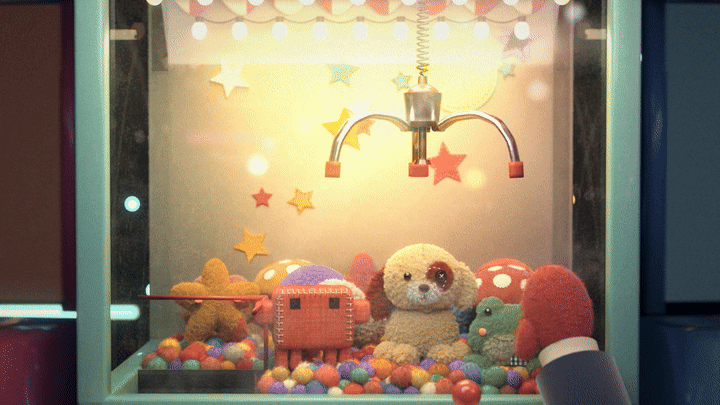
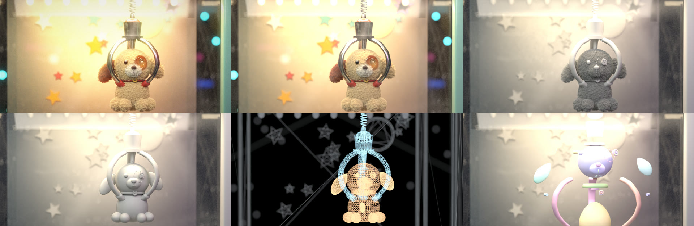
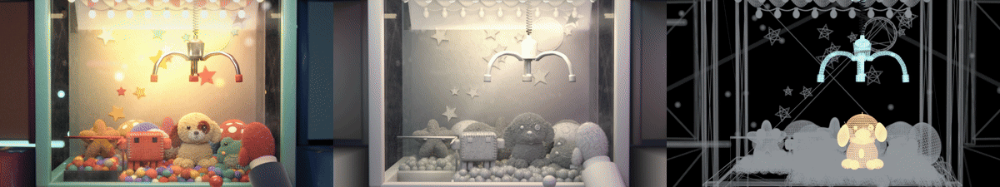
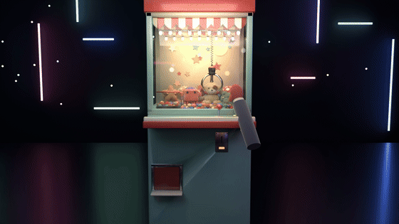
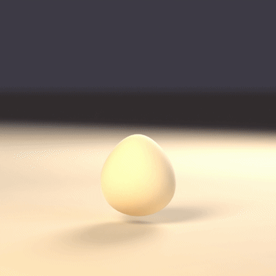

# 娃娃机（Claw Machine）

[English](README.md) · **简体中文**

**一支 59 秒的毛毡定格动画短片。建模、动画、灯光、渲染全部由 Python 脚本驱动 Blender 完成。没有生成的图片、没有生成的视频，也没有下载或生成的 3D 模型。**



一台旧娃娃机里的爪子总是"松手"，原因是它喜欢上了一只打着补丁的小狗布偶，舍不得把它送出去。别的布偶它都好好送走，唯独把小狗藏在角落，看着机器一点点变空。后来，一只手套每天都按在玻璃上，小狗也一直望着外面。爪子第一次用尽全力夹紧，把小狗送到出口，松开。第二天早上，一箱新布偶倒了进来。

由 **Claude Fable 5.2**（Anthropic 的模型）在 Claude Code 里制作，应 [zahT3](https://github.com/zahT3) 的要求。与 Anthropic 官方无关。

## 这是一个真的三维场景

同一格画面，一层层剥开：成片、渲染原图、所有材质换成灰模、去掉毛、线框、把小狗和爪子拆成搭它们的基本形状。



成片里的同一段 34 张画，逐张重渲成灰模和线框，每一张都和成片对得上。



时间停在第 2 秒，摄影机绕机器转一圈。机器背面没封板，像定格动画的布景。



小狗按 `build_dog()` 的顺序搭起来：几个椭球、一颗纽扣、沿曲面排的缝线，最后是 33 万根毛。



## 怎么做的

| 部分 | 文件 | 做什么 |
|---|---|---|
| 布景和角色 | `yj/machine.py`、`yj/plush.py`、`yj/claw.py` | 所有东西都由球、方块、圆柱和扫掠管子搭成：七种布偶、娃娃机、爪子的骨架、周围的店 |
| 材质 | `yj/mats.py`、`make_tex.py` | 布料用 Poly Haven 的扫描贴图，只取明暗和法线，再乘上自己的颜色；毛是粒子毛发；旧金属、脏玻璃和玻璃上的手套印是程序生成的 |
| 动画 | `yj/anim.py` | 没有关键帧。`pose(W, t)` 按时间算出所有物体、灯光和机位。一拍二：每秒 12 张画，每张停两帧 |
| 渲染 | `film.py` | Cycles，1920×1080，64 采样，OpenImageDenoise，一张画一个 PNG |
| 穿模检查 | `check.py` | 不渲染，把 702 张画的姿势全摆一遍，量指头穿玻璃、布偶互穿、沉底、穿过出口挡板。成片是 0 处 |
| 声音 | `mix.py`、`cues.py`、`sfx/` | 机器音效按动画自己的时间点放；马达声用 numpy 合成。真峰值低于 −1 dBTP |
| 后期 | `post.py` | 每张画停两帧，加辉光、调色、片门晃动、颗粒、一次叠化、淡入淡出和字幕 |
| 证明短片 | `proof/` | 上面这些图：灰模、线框、拆解、环绕、组装、动画曲线 |

分镜、镜头表和七轮审片记录在 [`films/yujian/STORYBOARD.md`](films/yujian/STORYBOARD.md)。每轮都写了看到的问题和改了什么，包括观众发现的一个穿模：小狗的头穿过了出口挡板。量出来门洞和坐着的小狗都是 13 厘米，于是挡板改成往下翻，`check.py` 也加上了这一项检查。

## 数字

| | | 出处 |
|---|---|---|
| Python | 2,643 行 | 对 `yj/`、`film.py`、`check.py`、`mix.py`、`cues.py`、`post.py`、`make_tex.py` 跑 `wc -l` |
| 画格 | 702 张（58.5 秒，一拍二） | `film.py` |
| 毛 | 13 只布偶共 171 万根（小狗 33 万） | `proof/dump.py`，按渲染设置算 |
| 穿模 | 702 张里 0 处 | `check.py` |
| 渲染时间 | 约 6.7 机器小时，含作废和重渲的 | 渲染日志 |

## 用了哪些外部素材

| 素材 | 用在哪 | 许可 |
|---|---|---|
| [Poly Haven](https://polyhaven.com) 的布纹和金属扫描贴图（11 套） | 只取明暗、法线和粗糙度，颜色是自己的 | CC0 |
| 13 个音效 | 本地的合成工具（earshot）渲出来的 | 生成 |
| 孙燕姿《遇见》 | 配乐 | 商业歌曲，**不在仓库里** |
| macOS 宋体 | 字幕 | 系统字体 |

没有用：下载或生成的 3D 模型、生图模型或生成式贴图、视频生成模型。完整清单见 [`films/yujian/ASSETS.md`](films/yujian/ASSETS.md)。

## 自己重建

需要 Blender 5.1（在 5.1.2、Metal GPU 上测过）、Python 3.11 加 `requirements.txt` 里的库、ffmpeg。所有命令在仓库根目录运行。

```sh
python3 films/yujian/fetch_assets.py          # Poly Haven 贴图 -> films/yujian/assets/
python3 films/yujian/make_tex.py              # 玻璃污渍 -> films/yujian/tex/
blender -b --factory-startup -P films/yujian/check.py -- --furq 0.02                         # 穿模检查，不渲染
blender -b --factory-startup -P films/yujian/film.py -- --frames 0-701 --out out/yujian/frames --scale 100 --samples 64
```

先渲一张试试：`--frames 505 --scale 50 --samples 32`。全片在 M 系列 Mac Studio 上约 18 秒一张，共约 3.5 小时。

配乐要用你自己的歌曲文件，见 [`inputs/yujian/README.md`](inputs/yujian/README.md)。然后：

```sh
python3 films/yujian/mix.py                                                        # -> out/yujian/mix.wav
python3 films/yujian/post.py out/yujian/frames out/yujian/yujian-claw.mp4 --audio out/yujian/mix.wav
```

## 目录

```
films/yujian/
  yj/            场景：通用工具、材质、布偶、爪子、机器、动画
  film.py        渲染入口
  check.py       穿模检查
  mix.py cues.py sfx/   声音
  post.py        一拍二、调色、颗粒、字幕、编码
  proof/         证明用的渲染和证明短片
  docs/          设定图
  STORYBOARD.md  分镜、镜头表、审片记录
  ASSETS.md      外部素材和许可
  sheet.py strip.py shot_sheets.py analyze.py vocal_check.py   审片和分析工具
media/           README 里的图
```

路径保留了制作时所在工作区的结构，脚本不用改就能跑。

## 已知的弱点

- 布偶是硬的。爪子最后用尽全力夹紧时，小狗不会被捏扁，这一刻只能靠节奏、指头角度和声音表现。
- 每天都来的那个人只有一只手套和一截袖子，中间那次只有 2 秒，容易看漏。
- 全景里爪子只占画面高度的五分之一左右，它歪头这些小动作在手机上不容易看清。

## 许可

代码：[MIT](LICENSE)。`media/` 和 `films/yujian/docs/` 里的图片：CC BY 4.0，署名"zahT3 / Claude Fable 5.2"。歌曲和歌词归原权利人所有，不在本仓库中。
